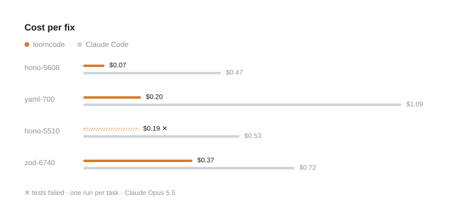

# loomcode

A small, fast terminal coding agent built on the [Claude Agent SDK](https://www.npmjs.com/package/@anthropic-ai/claude-agent-sdk) and Bun.

It replaces Claude Code's built-in tools with five lean ones and adds a hand-written TUI, so you can get more done with fewer tokens.

## Features

- **Five tools** (served over an in-process MCP server):
  - `read`: numbered file lines
  - `search`: ripgrep
  - `edit`: batched exact-text replacements
  - `shell`: zsh
  - `script`: JavaScript that chains the other tools and returns only what it prints
- **Native TUI** that renders:
  - streamed thinking
  - markdown and tables
  - syntax highlighting
  - a files drawer
  - pasted or dropped images
- **Your integrations**: MCP servers from `~/.claude.json` and `.mcp.json`, plus Claude in Chrome. claude.ai connectors are opt-in.
- **Compaction** with checkpoints saved to disk, so long sessions keep going.
- **Plain and JSON modes** for scripts and benchmarks.

## Benchmarks



| | loomcode | Claude Code | |
|---|---:|---:|---|
| Total cost | $0.83 | $2.82 | **3.4× cheaper** |
| Tokens processed | 560k | 4.24M | **7.6× fewer** |
| Wall time | 5.2 min | 9.2 min | **1.7× faster** |
| Cost per solved task | $0.28 | $0.70 | **2.5× cheaper** |
| Tests passed | 3 / 4 | 4 / 4 | |

Four real bug-fix pull requests, merged in [hono](https://github.com/honojs/hono), [yaml](https://github.com/eemeli/yaml)
and [zod](https://github.com/colinhacks/zod) after the model's training cutoff. The agent gets only the issue text in a
fresh checkout, and the pull request's own tests decide pass or fail. Both harnesses ran Claude Opus 5.5 at the same
effort setting, one run per task (November 8, 2026).

loomcode solved 3 of 4 (it missed an edge case in hono-5510) and Claude Code solved 4 of 4. Counting that miss, each
solved task still cost 2.5× less. With four tasks and one run each, treat these as early numbers.

Raw numbers: [docs/bench/runs.csv](docs/bench/runs.csv).

## Requirements

- [Bun](https://bun.sh) ≥ 1.3
- [ripgrep](https://github.com/BurntSushi/ripgrep) (`brew install ripgrep`)
- One of these for auth:
  - a Claude login (`claude` CLI)
  - `ANTHROPIC_API_KEY`
- macOS or Linux. Image paste uses macOS `sips`.

## Install

```sh
bun add -g github:ujj-exe/loomcode   # puts `loomcode` on your PATH
loomcode                             # first run walks you through setup
```

Setup checks that Claude Code is installed and signed in (loomcode runs on that login), then offers web
search through [Exa](https://exa.ai), [Firecrawl](https://firecrawl.dev) or [Context.dev](https://context.dev).
Paste a key and it is tested with one search, then saved to the system keychain (macOS Keychain, service
`loomcode`), never to a file. Skipping is fine: loomcode works without web access, and `loomcode --setup`
changes this later. With a provider set, the agent gets `web_search` and `web_fetch`.

From a clone, `bun install && bun link` makes `loomcode` run your working copy, so edits apply without
reinstalling. Global installs land in `~/.bun/bin`, which must be on your PATH.

Update:

```sh
loomcode --update   # installs the latest commit on main (in a clone: git pull + bun install)
```

Re-running `bun add -g` does not update: bun keeps the commit it first installed. The TUI checks GitHub once a
day and shows a notice when a newer version is out.

Uninstall:

```sh
bun remove -g loomcode                     # or `bun unlink` in the clone
rm -f ~/.loom/code.json ~/.loom/tui.json   # settings; leave the rest of ~/.loom (Loom.app uses it)
security delete-generic-password -s loomcode -a exa   # web search key, if saved (account: exa, firecrawl or context)
```

## Usage

```sh
loomcode                            # interactive TUI in the current directory
loomcode "fix the failing test"     # one-shot, plain output
loomcode --json "…"                 # final result as JSON on stderr, for benchmarks
```

From a clone: `bun install`, then `bun src/cli.ts` in place of `loomcode`.

Options:

| Flag | |
|---|---|
| `--model <id>` | model to use |
| `--effort low\|medium\|high\|xhigh\|max` | thinking effort (default `medium`) |
| `--plain` | no TUI, even in a terminal |
| `--json` | also print the final result message as JSON (stderr) |
| `-v, --verbose` | print every SDK message in plain mode |
| `--setup` | check Claude Code and choose a web search provider |
| `--update` | update to the latest version on GitHub |

### In the TUI

**Commands:**

| Command | |
|---|---|
| `/model` | switch model |
| `/effort` | set thinking effort |
| `/copy` | copy the last reply (`/copy code` copies its last code block) |
| `/files` | show or hide the files drawer |
| `/mcp` | MCP servers and claude.ai connectors |
| `/compact` | summarize the conversation to free context |
| `/clear` | start a fresh conversation |
| `/help` | keys and commands |
| `/exit` | quit |

**Keys:**

| Key | |
|---|---|
| `enter` | send |
| `shift+enter`, `alt+enter`, `ctrl+j` | newline |
| `esc` | stop |
| `shift+tab` | cycle effort |
| `ctrl+b` | files drawer |
| `ctrl+v` | paste image |
| `ctrl+c` | clear; press twice to quit |

## Layout

```
src/
  cli.ts            entry: TUI or plain mode
  session.ts        Agent SDK session, MCP servers, approvals
  tools.ts          read / search / edit / shell / script
  script*.ts        script runner (a Worker, so timeouts can kill it; not a sandbox)
  edit.ts           exact-text edit engine
  compact.ts        compaction + checkpoints
  prompt.ts         system prompt
  tui/              renderer, editor, markdown, highlight, drawer, images
```

## Development

```sh
bun test     # tools + TUI tests
bunx tsc --noEmit   # type check
```
